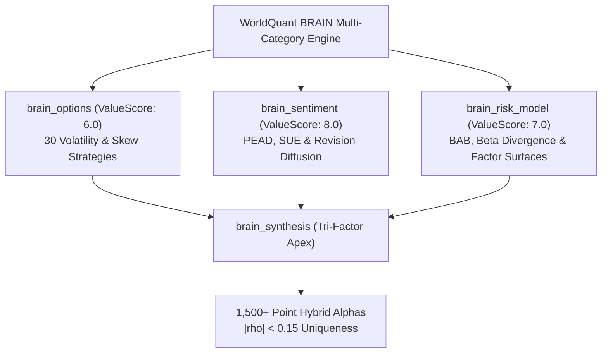

# brain-alpha-pipeline

Autonomous WorldQuant BRAIN alpha discovery, simulation, orthogonalization, and reserve vault pipeline.

[](https://github.com/Xtley001/brain-alpha-pipeline/actions)
[](https://github.com/Xtley001/brain-alpha-pipeline/actions/workflows/libraries-ci.yml)
[](./LICENSE)
[](https://www.python.org/downloads/)
[](https://pypi.org/project/brain-synthesis/)

`brain-alpha-pipeline` is an institutional quantitative alpha research pipeline and modular library suite for WorldQuant BRAIN. It mines high-value, uncrowded data categories—Options Analytics (ValueScore: 6.0), Systematic Risk Models (ValueScore: 7.0), and Analyst Sentiment (ValueScore: 8.0)—while applying 6-axis orthogonal decorrelation to guarantee sub-0.70 correlation against existing platform submissions. State is persisted in Neon PostgreSQL with zero-config local fallback. For the full quantitative methodology and mathematical specifications, see the [whitepaper](./docs/institutional_sentiment_and_risk_canon.md).

## Quickstart

### Option A: Install Modular Libraries via Pip & Use Unified CLI

```bash
# Install the complete 7-library suite and global CLI
pip install brain-synthesis

# Generate 3 candidates across all high-value data domains
brain generate --domain all --count 3

# Apply orthogonal decorrelation transforms to pass BRAIN's correlation gate (|rho| < 0.70)
brain decorrelate "rank(implied_volatility_call_30)" --base-sharpe 1.55

# Inspect storage subsystem health and cache counts
brain store
```

### Option B: Local Repository Setup & Autonomous 24/7 Miner

```bash
git clone https://github.com/Xtley001/brain-alpha-pipeline.git
cd brain-alpha-pipeline
pip install -r requirements.txt
cp .env.example .env   # configure BRAIN, Neon DB, and Telegram credentials

# Launch autonomous multi-worker vault miner
python scripts/autonomous_24h_vault_miner.py
```

## Architecture



```
brain-alpha-pipeline/
├── brain_libraries/          # 7 standalone pip-installable packages
│   ├── brain_core/           # Type contracts, AST deduplication, config
│   ├── brain_store/          # PostgreSQL + local JSON/CSV persistence
│   ├── brain_decorrelator/   # 6-axis orthogonal decorrelation engine
│   ├── brain_options/        # Options IV surface & breakeven generator
│   ├── brain_sentiment/      # PEAD & analyst revision diffusion engine
│   ├── brain_risk_model/     # Systematic factor premia & BAB engine
│   └── brain_synthesis/      # Tri-factor apex meta-synthesis & unified CLI
├── scripts/                  # Standalone 24/7 vault miner & backtest utilities
├── docs/                     # Extended whitepapers, guides & articles
│   ├── articles/             # 5-part WorldQuant BRAIN Masterclass series
│   └── HOW_IT_WORKS.md       # Pipeline architecture & simulation lifecycle
└── .github/workflows/        # Continuous discovery & release automations
```

## Data Categories & Coverage

| Package | Category ID | ValueScore | Theoretical Foundation | Core Field Examples |
|---|---|:---:|---|---|
| [`brain-options`](./brain_libraries/brain_options) | `option` | **6.0** | Sinclair (2010), Bali (2008), Xing et al. (2010) | `implied_volatility_call_30`, `put_breakeven`, `forward_price` |
| [`brain-sentiment`](./brain_libraries/brain_sentiment) | `sentiment` | **8.0** | Chan et al. (1996), Bernard & Thomas (1989) | `snt1_d1_netearningsrevision`, `snt1_d1_earningssurprise` |
| [`brain-risk-model`](./brain_libraries/brain_risk_model) | `model` | **7.0** | Frazzini & Pedersen (2014), Ang et al. (2006) | `beta_last_60_days_spy`, `correlation_last_60_days_spy` |
| [`brain-synthesis`](./brain_libraries/brain_synthesis) | `hybrid` | **8.0+** | Orthogonal Tri-Factor Confluence | Cross-dataset composite formulations |

## Workflows

| Workflow | Trigger | Purpose |
|---|---|---|
| [`run.yml`](.github/workflows/run.yml) | 48× daily + manual | Discovers and simulates alpha candidates on WorldQuant BRAIN |
| [`drip.yml`](.github/workflows/drip.yml) | 3× daily (scheduled) | Submits 1 qualified orthogonal alpha from reserve vault to BRAIN |
| [`health.yml`](.github/workflows/health.yml) | Hourly | Transmits Telegram health heartbeat and discovery funnel telemetry |
| [`daily_digest.yml`](.github/workflows/daily_digest.yml) | Daily at 23:00 UTC | Generates end-of-day summary of simulated, qualified, and reserve alphas |
| [`libraries-ci.yml`](.github/workflows/libraries-ci.yml) | Push / PR | Runs test matrix across all 7 modular libraries (86 unit tests) |
| [`release.yml`](.github/workflows/release.yml) | Tag push (`v*`) | Builds and publishes distribution packages to PyPI |

## Testing

```bash
# Run test suite across all 7 modular libraries (86 tests)
python brain_libraries/test_all.py

# Or run pytest directly
pytest --import-mode=importlib brain_libraries/*/tests -v
```

## Security

Report vulnerabilities per our [security policy](./SECURITY.md). Never commit API keys or PostgreSQL credentials; all secrets must be configured via environment variables.

## Contributing

See [CONTRIBUTING.md](./CONTRIBUTING.md) for code style, AST compiler constraints, and pull request guidelines.

## License

Released under the [MIT License](./LICENSE). Maintained by [Xtley001](https://github.com/Xtley001).
