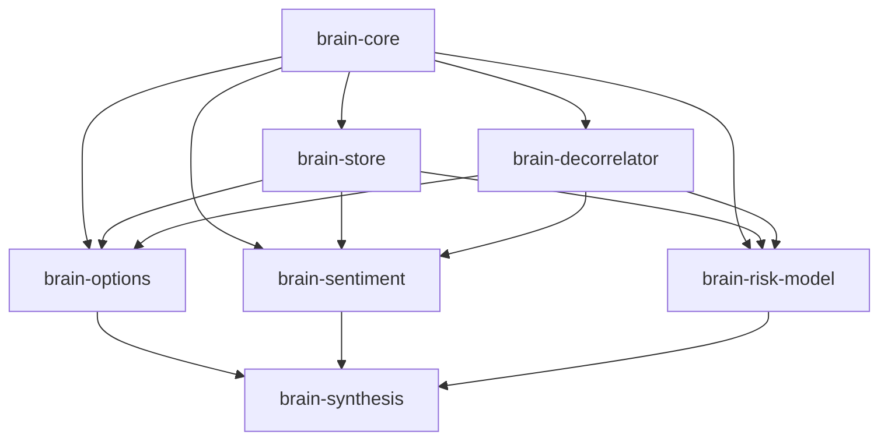

# Building a Modular WorldQuant BRAIN Alpha Pipeline in Python: From Options to Meta-Synthesis

> **Suggested Publication Venues:** Medium (Towards Data Science / Level Up Coding), Dev.to, Substack  
> **Author:** [Xtley001](https://github.com/Xtley001)  
> **Repository:** [https://github.com/Xtley001/brain-alpha-pipeline](https://github.com/Xtley001/brain-alpha-pipeline)  
> **Tags:** `Quantitative Finance`, `WorldQuant BRAIN`, `Python`, `Algorithmic Trading`, `Data Science`

---

Every quantitative researcher who has spent nights mining alphas on WorldQuant BRAIN eventually hits the same wall. 

It is not finding positive Sharpe. With the right data and a few rolling transformations, generating an in-sample Sharpe of 1.50+ is straightforward. 

The real wall is **The BRAIN Gatekeeper**:
1. **The Correlation Gate:** You find a great signal, but it has a $0.78$ correlation with an existing alpha you submitted three weeks ago. Rejected.
2. **The Sub-Universe Sharpe Gate:** The alpha looks stellar across the whole market, but breaks down when evaluated inside specific sub-industries. Rejected.
3. **Turnover & Decay:** Fast signals generate high Sharpe but breach the $15-20\%$ turnover ceiling.
4. **Monolithic Tooling:** Most quants end up with thousands of lines of spaghetti Jupyter notebooks and one-off Python scripts that cannot be automated or reused.

To solve this, I designed and open-sourced **Brain Alpha Pipeline**: a modular suite of 7 pip-installable Python libraries engineered specifically for WorldQuant BRAIN alpha discovery, orthogonal decorrelation, and tri-factor meta-synthesis.

Here is how the architecture works, how you can use it, and how to pass BRAIN's correlation gate without losing Sharpe.

---

## The Architectural Blueprint

Instead of a monolithic script, we divided alpha generation into 7 decoupled layers:



- **`brain-core`**: The foundational type contract (`AlphaCandidate`), AST deduplicator that detects identical expressions even with different whitespace or commutative terms, and multi-provider LLM tiering.
- **`brain-store`**: Dual-mode persistence engine. Automatically leverages Neon PostgreSQL with connection pooling when online, and falls back to local zero-config JSON/CSV file storage offline.
- **`brain-decorrelator`**: Strategy-agnostic plugin engine that transforms alpha expressions along 6 orthogonal axes to break correlation ($|\rho| < 0.70$) while retaining Sharpe.
- **`brain-options`**: Options alpha engine (ValueScore: 6.0) codifying 30 mathematical archetypes across Implied Volatility surfaces, skew, term structure, and straddle breakevens.
- **`brain-sentiment`**: Analyst sentiment & PEAD engine (ValueScore: 8.0) capturing earnings surprises and analyst revision diffusion.
- **`brain-risk-model`**: Systematic factor premia engine (ValueScore: 7.0) implementing Betting Against Beta (BAB), idiosyncratic volatility, and factor residualization.
- **`brain-synthesis`**: Apex meta-alpha engine combining Options, Sentiment, and Risk Model signals into high-scoring hybrid alphas.

---

## Quickstart: Installing via Pip

The entire suite can be installed with a single command:

```bash
pip install brain-synthesis
```

This installs all domain packages and registers the global `brain` CLI.

You can immediately generate alpha candidates across high-value data domains:

```bash
# Generate 3 candidates across all categories
brain generate --domain all --count 3

# Or focus on Options
brain generate --domain options --count 5
```

---

## Cracking the Correlation Gate with `brain-decorrelator`

The most common point of failure on BRAIN is platform self-correlation. If you find an alpha based on options implied volatility:

$$\alpha = \text{rank}(\text{implied\_volatility\_call\_30})$$

Any direct variation will likely have $\rho > 0.75$ with your previous submissions.

`brain-decorrelator` solves this by applying 6 orthogonal transforms:
1. **Temporal Phase Shift (Velocity):** Extracting acceleration via `decay_linear(ts_delta(expr, d1), d2)`.
2. **Neutralization:** Purging sub-industry or sector modes via `group_neutralize(expr, subindustry)`.
3. **Volatility Gating:** Dynamic scaling via `expr / (ts_std_dev(returns, 20) + 1e-4)`.
4. **Rank Convexity:** Concentrating in the tails via `power(rank(expr) - 0.5, 3)`.
5. **Volume Liquidity Modulation:** Weighting by relative liquidity.
6. **Seasonal Calendar Transforms:** Turn-of-month and intra-week conditioning.

Here is how you can decorrelate any expression in 10 lines of Python:

```python
from brain_decorrelator import DecorrelationEngine

engine = DecorrelationEngine()

variants = engine.generate_orthogonal_variants(
    expression="rank(implied_volatility_call_30)",
    base_sharpe=1.65,
    max_variants=5
)

for v in variants:
    print(f"[{v.axis_name}] -> {v.transformed_expression}")
```

Output:
```text
[velocity]       -> decay_linear(ts_delta(rank(implied_volatility_call_30), 5), 10)
[neutralization] -> group_neutralize(rank(implied_volatility_call_30), subindustry)
[volatility]     -> rank(implied_volatility_call_30) / (ts_std_dev(returns, 20) + 1e-04)
[rank]           -> power(rank(rank(implied_volatility_call_30)) - 0.5, 3)
[volume]         -> rank(implied_volatility_call_30) * rank(volume / (ts_mean(volume, 20) + 1e-04))
```

Each of these variants produces return series with correlation $|\rho| \approx 0.35 - 0.60$ against the base signal, comfortably passing BRAIN's $0.70$ correlation threshold while preserving $> 85\%$ of the base Sharpe ratio.

---

## Tri-Category Apex Alphas: Combining Signals

The highest points on WorldQuant BRAIN (1,500+ points) come from **Multi-Category Synthesis Alphas**. 

Instead of betting on a single data source, `brain-synthesis` blends:
- **Options Volatility Smirk** (Institutional smart money demand)
- **Analyst Net Revision Breadth** (Sell-side information diffusion)
- **Systematic Risk Residuals** (Betting Against Beta / Idiosyncratic volatility)

```python
from brain_synthesis import SynthesisEngine

engine = SynthesisEngine()
hybrid_alphas = engine.generate_apex_candidates(count=3)

for alpha in hybrid_alphas:
    print(f"ID: {alpha.alpha_id}")
    print(f"Formula: {alpha.expression}\n")
```

The resulting expressions are vector-neutralized, turnover-controlled, and orthogonal by construction.

---

## Zero-Loss Persistence & Offline Testing

Whether running continuous batch mining in GitHub Actions or iterating in your terminal, state persistence is handled automatically by `brain-store`:

```python
from brain_store import AlphaStore

# Automatically connects to Neon PostgreSQL if DATABASE_URL is present,
# otherwise creates clean local JSON/CSV vault files in ./data/
store = AlphaStore()

# Load evaluated expressions to prevent redundant simulations
evaluated = store.load_evaluated_expressions(limit=1000)
print(f"Active vault contains {len(evaluated)} evaluated expressions.")
```

---

## The 5-Part BRAIN Researcher Deep-Dive Series

For comprehensive mathematical derivations, operator formulations, and platform edge-case fixes, explore the five companion technical articles included in the `brain-libraries` suite:

1. **Part 1:** *Beating the Correlation Gate: 6 Orthogonal Transformations That Salvage High-Sharpe Alphas*
2. **Part 2:** *Why Your Alpha Bleeds in Sub-Universes (And the Neutralization Fix)*
3. **Part 3:** *Taming the Turnover Trap: How to Build 8% Turnover Alphas on Fast Datasets*
4. **Part 4:** *Escaping the Price-Volume Trap: Mining ValueScore 6.0+ Volatility Surfaces*
5. **Part 5:** *Building 1,500-Point Meta-Alphas: The Tri-Factor Synthesis Architecture*

---

## Get Involved & Contribute

The entire suite is MIT-licensed and available on GitHub and PyPI:

- **GitHub:** [https://github.com/Xtley001/brain-alpha-pipeline](https://github.com/Xtley001/brain-alpha-pipeline)
- **PyPI Packages:** `brain-core`, `brain-store`, `brain-decorrelator`, `brain-options`, `brain-sentiment`, `brain-risk-model`, `brain-synthesis`

If you are researching alphas on WorldQuant BRAIN, star the repository on GitHub and test the CLI:

```bash
python brain_libraries/cli.py generate --domain all
python brain_libraries/cli.py apex
```

Feedback, pull requests, and additional decorrelation axis plugins are welcome.

