# 🔬 Master Surgical Extraction & Pipeline Orchestration Plan

> **Author:** Quantitative Alpha Research & Orchestration Team  
> **Repository:** `brain-alpha-pipeline`  
> **Target:** Exhaustive, Paper-Exact Extraction of All Remaining 43 Quantitative Finance Materials (Total 89)  
> **Governing Protocol:** "Brain Surgery Precision" — Zero Batch Overloading, Zero Hallucinations, 15–25 Verbatim Extracts per KB, 100% Traceability Feedback Audit per Step.

---

## 1. Executive Mission & Core Governing Principles

This document establishes the **exhaustive, step-by-step surgical roadmap** to extract, ground, and operationalize the remaining 43 institutional quantitative finance papers and treatises currently residing in `docs/kb/extracted_text/`.

### 🛡️ The 5 Invariant Rules of Engagement
1. **Zero Hallucination Guarantee:**  
   Every equation, regression coefficient, $t$-statistic, table value, and economic hypothesis must be quoted verbatim from the raw `.txt` file on disk. No parameter may be invented.
2. **Surgical Granularity (No Overloaded Batching):**  
   Materials are grouped into **16 small, focused steps** (2–3 closely related companion papers or single landmark treatises per step). No step will combine disparate topics.
3. **The 5-Stage Protocol per Step:**  
   Each surgical step must execute sequentially through 5 verifiable gates:
   - **Gate 1 (Deep Reading):** Inspect raw text in `docs/kb/extracted_text/<paper>.txt`.
   - **Gate 2 (Knowledge Base):** Write `docs/kb/<pillar>/<name>.md` containing $\ge 15-20$ verbatim extracts, closed-form equations, tables, and mechanisms.
   - **Gate 3 (Generator Synthesis):** Code paper-grounded archetypes with valid BRAIN syntax, causal operators, balanced parentheses, and explicit `"source_kb"` links.
   - **Gate 4 (Feedback Audit):** Execute `python scripts/verify_pipeline_orchestration.py` to prove 0 syntax errors, 0 broken parens, and 100% traceability.
   - **Gate 5 (Git Checkpoint):** Stage, commit, and update `docs/kb/EXTRACTION_STATUS.md`.
4. **AI Architecture Distinct Handling:**  
   The 5 modern AI papers (AQuA, QuantaAlpha, AlphaAgentEvo, Trading-R1, AlphaMemo) are already synthesized into `docs/kb/frameworks/ai_agentic_evolutionary_mining_architecture.md` as the cognitive operating system of our autonomous agent.
5. **Continuous Traceability Invariant:**  
   Candidate pool traceability must remain at **100.0%** at every single commit.

---

## 2. Current Progress Baseline (46 Completed / 43 Remaining)

```
========================================================================================
CURRENT REPOSITORY AUDIT STATE:
  - Total Candidates Generated:     3,713 candidates
  - Expression Syntax Health:       100% OK (0 unbalanced parens, 0 duplicate names)
  - Source KB Traceability:         100.0% (3,713 / 3,713 candidates grounded)
  - Deep Research KBs on Disk:      17 documents (each with 14–20 verbatim extracts)
  - Total Academic Materials Done:  46 materials (Pillar 6 Supply Chain is 100% Complete)
  - Remaining Materials to Extract: 43 materials (Grouped into 16 Surgical Steps)
========================================================================================
```

---

## 3. The 16 Surgical Steps (Exhaustive Roadmap)

```mermaid
graph TD
    subgraph Wave 1: Options Volatility Surface [17 Materials / 6 Steps]
        S1A["Step 1A: Bali-Hovakimian & Delisle-Lee (IV Spreads & Shorts)"]
        S1B["Step 1B: Garleanu-Pedersen-Poteshman (Demand-Based Pricing)"]
        S1C["Step 1C: Bakshi-Kapadia-Madan (Implied Skewness & Kurtosis)"]
        S1D["Step 1D: Ni-Pearson-Poteshman & Michael et al. (Pinning & Flow)"]
        S1E["Step 1E: Carr-Madan & Bollerslev-Tauchen-Zhou (VRP & Replications)"]
        S1F["Step 1F: Natenberg, Sinclair, Derman & Bennett (Vol Surface Treatises)"]
    end
    subgraph Wave 2: Risk Models & Systematic Factors [6 Materials / 2 Steps]
        S2A["Step 2A: An-Ang-Bali & Baker-Bradley-Wurgler (Joint Vol Cross-Section)"]
        S2B["Step 2B: Savor-Wilson, Nieto-Rodriguez & Merton (Macro & Credit Drift)"]
    end
    subgraph Wave 3: Sentiment & PEAD [12 Materials / 4 Steps]
        S3A["Step 3A: Chan-Jegadeesh-Lakonishok & Ball-Brown (Classic PEAD Foundations)"]
        S3B["Step 3B: Edmans-Garcia-Norli & Loh-Stulz (Exogenous Shocks & Bad Times)"]
        S3C["Step 3C: Asquith et al., Floropoulos & Silver (Analyst Text & Horizons)"]
        S3D["Step 3D: Fink, Harshita & Martineau (Modern PEAD Synthesis Trilogy)"]
    end
    subgraph Wave 4: Short Interest [2 Materials / 1 Step]
        S4A["Step 4A: Engelberg-Reed-Ringgenberg 2018 & Staley (Loan Risk & Practice)"]
    end
    subgraph Wave 5: Fundamental & Active Portfolio [4 Materials / 2 Steps]
        S5A["Step 5A: Kruger (Fund Performance Persistence)"]
        S5B["Step 5B: Fabozzi & Grinold-Kahn (Active Management Foundations)"]
    end
    subgraph Wave 6: Quantitative Frameworks [2 Materials / 1 Step]
        S6A["Step 6A: Tulchinsky & Lopez de Prado (WorldQuant Operators & AFML)"]
    end

    S1A --> S1B --> S1C --> S1D --> S1E --> S1F
    S1F --> S2A --> S2B
    S2B --> S3A --> S3B --> S3C --> S3D
    S3D --> S4A
    S4A --> S5A --> S5B
    S5B --> S6A
```



---

### WAVE 1: Options & Volatility Surface (17 Materials / 6 Steps)

#### 🔹 Step 1A: Implied Volatility Spreads & Option-Short Interactions (2 Papers)
- **Materials:**
  1. `Bali_Hovakimian_Volatility_Spreads.txt` (Bali & Hovakimian 2009, *Management Science*)
  2. `Delisle_Lee_Mauck_2011_Short_Sellers_Option_Traders.txt` (Delisle, Lee & Mauck 2011, *JBF*)
- **Target KB:** `docs/kb/options/bali_hovakimian_delisle_vol_spreads.md`
- **Core Formulations:**
  - Call-Put IV spread: $VS_t = IV_{\text{call},t}^{\text{ATM}} - IV_{\text{put},t}^{\text{ATM}}$
  - Net option sentiment interacting with short interest loan fee constraints
- **Generator Target:** `brain_generators/options/bali_hovakimian_vol_spread.py`
- **Output:** ~100 candidate expressions.

#### 🔹 Step 1B: Demand-Based Option Pricing & Inventory Frictions (2 Papers)
- **Materials:**
  1. `Garleanu_Pedersen_Demand_Based_Option_Pricing.txt` (Garleanu, Pedersen & Poteshman 2009, *RFS*)
  2. `Garleanu_Pedersen_Poteshman_2009_Demand_Based_Option_Pricing_v2.txt` (GPP 2009 Companion)
- **Target KB:** `docs/kb/options/garleanu_pedersen_demand_pricing.md`
- **Core Formulations:**
  - Non-market-maker end-user net demand pressure: $\Delta \sigma_t(K, T) = \lambda \cdot D_t(K, T) + \gamma \cdot \text{Var}(D_t)$
  - Implied volatility markup due to unhedgeable market-maker jump and vega inventory risks.
- **Generator Target:** `brain_generators/options/garleanu_pedersen_demand.py`
- **Output:** ~100 candidate expressions.

#### 🔹 Step 1C: Model-Free Risk-Neutral Skewness & Kurtosis (2 Papers)
- **Materials:**
  1. `Bakshi_Kapadia_Madan_2003_RFS.txt` (Bakshi, Kapadia & Madan 2003, *RFS*)
  2. `Bakshi_Kapadia_Madan_Skew_Laws.txt` (BKM 2003 Power Laws)
- **Target KB:** `docs/kb/options/bakshi_kapadia_madan_skew_kurtosis.md`
- **Core Formulations:**
  - Model-free risk-neutral moments extracted from OTM call/put strips:
    $$SKEW(t, \tau) = \frac{E^Q[(R_t(\tau) - \mu)^3]}{E^Q[(R_t(\tau) - \mu)^2]^{3/2}}, \quad KURT(t, \tau) = \frac{E^Q[(R_t(\tau) - \mu)^4]}{E^Q[(R_t(\tau) - \mu)^2]^2}$$
  - Negative skewness risk premium in the cross-section of equities.
- **Generator Target:** `brain_generators/options/bakshi_kapadia_madan_skew.py`
- **Output:** ~100 candidate expressions.

#### 🔹 Step 1D: Expiration Strike Pinning & Order Flow Imbalance (2 Papers)
- **Materials:**
  1. `Ni_Pearson_Poteshman_2005_Stock_Price_Pinning_Option_Expiration.txt` (Ni, Pearson & Poteshman 2005, *JF*)
  2. `Michael_Cucuringu_Howison_2020_Option_Volume_Imbalance.txt` (Michael, Cucuringu & Howison 2020, *Oxford*)
- **Target KB:** `docs/kb/options/ni_pearson_pinning_cucuringu_flow.md`
- **Core Formulations:**
  - Strike pinning clustering around high-open-interest strikes on third Fridays:
    $$\text{PinningPull} = \text{sign}(K^* - S_t) \cdot \frac{\text{OI}(K^*)}{ADV_{20}}$$
  - High-frequency option order flow imbalance (OFI) leading underlying equity quotes.
- **Generator Target:** `brain_generators/options/ni_pearson_pinning.py`
- **Output:** ~100 candidate expressions.

#### 🔹 Step 1E: Variance Risk Premia & Contract Replications (3 Papers)
- **Materials:**
  1. `Carr_Madan_2001_Theory_of_Volatility_Trading.txt` (Carr & Madan 2001, European Finance)
  2. `Bollerslev_Tauchen_Zhou_2009_Expected_Returns_Variance_Risk_Premia.txt` (BTZ 2009, *RFS*)
  3. `Bollerslev_Tauchen_Zhou_2009_Variance_Risk_Premia_v2.txt` (BTZ 2009 Companion)
- **Target KB:** `docs/kb/options/carr_madan_bollerslev_vrp.md`
- **Core Formulations:**
  - Variance Risk Premium: $VRP_{i,t} = IV_{i,t}^2 - RV_{i,t}^2$
  - Log contract dynamic replication and jump robust variance swaps.
- **Generator Target:** `brain_generators/options/bollerslev_vrp_dynamics.py`
- **Output:** ~100 candidate expressions.

#### 🔹 Step 1F: Institutional Volatility Surface Treatises (5 Books)
- **Materials:**
  1. `Natenberg_Option_Volatility_and_Pricing.txt` (Sheldon Natenberg)
  2. `Sinclair_Volatility_Trading.txt` (Euan Sinclair — Volatility Trading)
  3. `Sinclair_Positional_Option_Trading.txt` (Euan Sinclair — Positional Option Trading)
  4. `Derman_Miller_The_Volatility_Smile.txt` (Emanuel Derman & Michael B. Miller)
  5. `Bennett_Trading_Volatility.txt` (Colin Bennett — Trading Volatility)
- **Target KB:** `docs/kb/options/natenberg_sinclair_derman_bennett_vol_treatise.md`
- **Core Formulations:**
  - Term structure slopes ($IV_{30} - IV_{90}$), ATM forward skew slopes ($\frac{\partial IV}{\partial \Delta}$), and volatility surface curvature ($2 \cdot IV_{\text{ATM}} - IV_{25\Delta C} - IV_{25\Delta P}$).
- **Generator Target:** `brain_generators/options/institutional_surface_treatise.py`
- **Output:** ~100 candidate expressions.

---

### WAVE 2: Risk Models & Systematic Factors (6 Materials / 2 Steps)

#### 🔹 Step 2A: Joint Cross-Section of Volatility & Limits of Arbitrage (2 Papers)
- **Materials:**
  1. `An_Ang_Bali_Joint_Cross_Section.txt` (An, Ang, Bali & Cakici 2014, *JFE*)
  2. `Baker_Bradley_Wurgler_2011_Benchmarks_Limits_Arbitrage_Low_Volatility.txt` (BBW 2011, *FAJ*)
- **Target KB:** `docs/kb/risk_models/an_ang_bali_baker_joint_vol.md`
- **Core Formulations:**
  - Joint sorting on idiosyncratic volatility and past call/put returns.
  - Institutional benchmarking constraints forcing active managers to overpay for high-beta stocks.
- **Generator Target:** `brain_generators/risk_models/an_ang_bali_joint_vol.py`
- **Output:** ~80 candidate expressions.

#### 🔹 Step 2B: Macro Announcement Drift & Credit Structural Models (3 Papers)
- **Materials:**
  1. `Savor_Wilson_2013_Macroeconomic_Risk_Announcements.txt` (Savor & Wilson 2013, *JF*)
  2. `Nieto_Rodriguez_2013_Stock_Corporate_Bond_Returns.txt` (Nieto & Rodriguez 2013)
  3. `Merton_1974_Pricing_Corporate_Debt_Structural_Model.txt` (Merton 1974, *JF*)
- **Target KB:** `docs/kb/risk_models/savor_wilson_nieto_merton_macro_credit.md`
- **Core Formulations:**
  - Macro announcement beta premia across CPI, Nonfarm Payrolls, and GDP.
  - Merton structural distance-to-default ($DD = \frac{\ln(V/D) + (\mu - 0.5\sigma_V^2)T}{\sigma_V \sqrt{T}}$) and corporate bond yield spread spillover to equity.
- **Generator Target:** `brain_generators/risk_models/savor_wilson_macro_merton.py`
- **Output:** ~80 candidate expressions.

---

### WAVE 3: Sentiment, PEAD & Analyst Revisions (12 Materials / 4 Steps)

#### 🔹 Step 3A: Foundational PEAD & Price Momentum Decomposition (2 Papers)
- **Materials:**
  1. `Chan_Jegadeesh_Lakonishok_1996_Momentum_Strategies_PEAD.txt` (CJL 1996, *JF*)
  2. `Ball_Brown_1968_Accounting_Income_PEAD.txt` (Ball & Brown 1968, *JAR*)
- **Target KB:** `docs/kb/sentiment/cjl_1996_ball_brown_1968_pead.md`
- **Core Formulations:**
  - Standardized Unexpected Earnings ($SUE$) vs. pure 6-month price momentum.
  - 12-month post-earnings announcement drift across size and analyst coverage terciles.
- **Generator Target:** `brain_generators/sentiment/cjl_pead_momentum.py`
- **Output:** ~80 candidate expressions.

#### 🔹 Step 3B: Exogenous Mood Shocks & Crisis Analyst Informativeness (2 Papers)
- **Materials:**
  1. `Edmans_Garcia_Norli_2007_Sports_Sentiment_Stock_Returns.txt` (Edmans, Garcia & Norli 2007, *JF*)
  2. `Loh_Stulz_2018_Is_Sell_Side_Research_More_Valuable_in_Bad_Times.txt` (Loh & Stulz 2018, *JFE*)
- **Target KB:** `docs/kb/sentiment/edmans_garcia_loh_stulz_crisis_sentiment.md`
- **Core Formulations:**
  - Exogenous sentiment shocks inducing next-day price reversals.
  - Heightened informativeness of sell-side analyst revisions during high-dispersion / recession regimes.
- **Generator Target:** `brain_generators/sentiment/edmans_loh_stulz_crisis.py`
- **Output:** ~80 candidate expressions.

#### 🔹 Step 3C: Analyst Textual Reports & Multi-Horizon Revisions (3 Papers)
- **Materials:**
  1. `Asquith_Mikhail_Au_2005_Information_Content_Equity_Analyst_Reports.txt` (AMA 2005, *JFE*)
  2. `Floropoulos_2018_Informativeness_Short_Long_Term_Analyst_Forecasts.txt` (Floropoulos 2018)
  3. `Silver_Bazarova_2022_Price_Expectations_Financial_Markets.txt` (Silver & Bazarova 2022)
- **Target KB:** `docs/kb/sentiment/asquith_floropoulos_silver_analyst_horizons.md`
- **Core Formulations:**
  - Interaction of price target revisions, recommendation changes, and earnings revisions.
  - Divergence between short-term quarterly vs. long-term multi-year analyst projections.
- **Generator Target:** `brain_generators/sentiment/asquith_analyst_horizons.py`
- **Output:** ~80 candidate expressions.

#### 🔹 Step 3D: Comprehensive PEAD Literature Synthesis (3 Papers)
- **Materials:**
  1. `Fink_2020_Review_of_PEAD.txt` (Jason Fink 2020)
  2. `Harshita_Singh_Yadav_2018_PEAD_Market_Efficiency.txt` (Harshita et al. 2018)
  3. `Martineau_2021_Modern_PEAD.txt` (Charles Martineau 2021, *JFE*)
- **Target KB:** `docs/kb/sentiment/fink_harshita_martineau_modern_pead.md`
- **Core Formulations:**
  - Attention-driven PEAD: media coverage on earnings announcement date determining drift duration.
  - Cross-market PEAD speed of price discovery.
- **Generator Target:** `brain_generators/sentiment/martineau_attention_pead.py`
- **Output:** ~80 candidate expressions.

---

### WAVE 4: Short Interest & Securities Lending (2 Materials / 1 Step)

#### 🔹 Step 4A: Loan Fee Risk & Institutional Short Practice (2 Materials)
- **Materials:**
  1. `Engelberg_Reed_Ringgenberg_2018_Short_Selling_Risk.txt` (ERR 2018, *JFE*)
  2. `Staley_The_Art_of_Short_Selling.txt` (Kathryn Staley 1997 Book)
- **Target KB:** `docs/kb/short_interest/engelberg_2018_staley_short_risk.md`
- **Core Formulations:**
  - Loan fee risk volatility: stocks subject to unpredictable borrow fee spikes trade at significant premia.
  - Forensic accounting flags (unbilled receivables, revenue recognition changes) driving institutional short targets.
- **Generator Target:** `brain_generators/short_interest/err_staley_short_risk.py`
- **Output:** ~80 candidate expressions.

---

### WAVE 5: Fundamental Quality & Active Portfolio Management (4 Materials / 2 Steps)

#### 🔹 Step 5A: Mutual Fund Alpha Persistence (1 Paper)
- **Materials:**
  1. `Kruger_2007_Persistence_in_Mutual_Fund_Performance.txt` (Kruger 2007)
- **Target KB:** `docs/kb/fundamental/kruger_2007_fund_persistence.md`
- **Core Formulations:**
  - Persistence in top-decile active institutional manager factor exposures.
- **Generator Target:** `brain_generators/fundamental/kruger_fund_persistence.py`
- **Output:** ~50 candidate expressions.

#### 🔹 Step 5B: Institutional Active Equity Management Treatises (2 Classic Books)
- **Materials:**
  1. `Fabozzi_Quantitative_Equity_Investing.txt` (Frank Fabozzi 2010 Book)
  2. `Grinold_Kahn_Active_Portfolio_Management.txt` (Richard Grinold & Ronald Kahn 1999 Book)
- **Target KB:** `docs/kb/fundamental/fabozzi_grinold_kahn_active_equity.md`
- **Core Formulations:**
  - The Fundamental Law of Active Management: $IR \approx IC \cdot \sqrt{\text{Breadth}}$
  - Optimal risk budgeting, residual volatility neutralization, and multi-factor combining weights.
- **Generator Target:** `brain_generators/fundamental/grinold_kahn_fundamental_law.py`
- **Output:** ~60 candidate expressions.

---

### WAVE 6: Institutional Quantitative Frameworks (2 Materials / 1 Step)

#### 🔹 Step 6A: WorldQuant BRAIN Operator Canon & AFML Machine Learning (2 Books)
- **Materials:**
  1. `Tulchinsky_Finding_Alphas_WorldQuant.txt` (Igor Tulchinsky 2015 Book)
  2. `Lopez_de_Prado_AFML.txt` (Marcos López de Prado 2018 Book)
- **Target KB:** `docs/kb/frameworks/tulchinsky_lopez_de_prado_quant_canon.md`
- **Core Formulations:**
  - Tulchinsky's 151 real-world alpha archetypes and standard WorldQuant operator grammar.
  - López de Prado's Triple Barrier labeling method, Meta-labeling, and Bet Sizing.
- **Generator Target:** `brain_generators/fundamental/tulchinsky_151_operator_canon.py`
- **Output:** ~100 candidate expressions.

---

## 4. Execution Protocol & Verification Per Step

Every single step (from Step 1A to Step 6A) follows this exact deterministic cycle:

```
┌─────────────────────────────────────────────────────────────────────────────┐
│                       DETERMINISTIC 5-STAGE PROTOCOL                         │
├─────────────────────────────────────────────────────────────────────────────┤
│ 1. READ RAW TEXT:      Direct inspection of raw text in extracted_text/     │
│ 2. WRITE DEEP KB:      docs/kb/<pillar>/<file>.md (15–20 verbatim extracts) │
│ 3. WRITE GENERATOR:    brain_generators/<pillar>/<file>.py (~60-100 cands)   │
│ 4. INTEGRATE & AUDIT:  scripts/master_quintuple_vault_miner_500.py          │
│                        python scripts/verify_pipeline_orchestration.py      │
│ 5. GIT COMMIT & LOG:   git add + git commit + update EXTRACTION_STATUS.md   │
└─────────────────────────────────────────────────────────────────────────────┘
```

---

## 5. Summary Matrix of All 16 Steps

| Step | Wave | Materials Covered | Target KB File | Target Generator Module | Est. Candidates |
|---|---|---|---|---|---|
| **1A** | Options | Bali & Hovakimian (2009), Delisle et al. (2011) | `docs/kb/options/bali_hovakimian_delisle_vol_spreads.md` | `brain_generators/options/bali_hovakimian_vol_spread.py` | ~100 |
| **1B** | Options | Garleanu-Pedersen-Poteshman (2009 x2) | `docs/kb/options/garleanu_pedersen_demand_pricing.md` | `brain_generators/options/garleanu_pedersen_demand.py` | ~100 |
| **1C** | Options | Bakshi-Kapadia-Madan (2003 x2) | `docs/kb/options/bakshi_kapadia_madan_skew_kurtosis.md` | `brain_generators/options/bakshi_kapadia_madan_skew.py` | ~100 |
| **1D** | Options | Ni-Pearson-Poteshman (2005), Michael et al. (2020) | `docs/kb/options/ni_pearson_pinning_cucuringu_flow.md` | `brain_generators/options/ni_pearson_pinning.py` | ~100 |
| **1E** | Options | Carr-Madan (2001), Bollerslev et al. (2009 x2) | `docs/kb/options/carr_madan_bollerslev_vrp.md` | `brain_generators/options/bollerslev_vrp_dynamics.py` | ~100 |
| **1F** | Options | Natenberg, Sinclair (x2), Derman, Bennett (5 Books) | `docs/kb/options/natenberg_sinclair_derman_bennett_vol_treatise.md` | `brain_generators/options/institutional_surface_treatise.py` | ~100 |
| **2A** | Risk | An-Ang-Bali (2014), Baker-Bradley-Wurgler (2011) | `docs/kb/risk_models/an_ang_bali_baker_joint_vol.md` | `brain_generators/risk_models/an_ang_bali_joint_vol.py` | ~80 |
| **2B** | Risk | Savor-Wilson (2013), Nieto-Rodriguez (2013), Merton (1974) | `docs/kb/risk_models/savor_wilson_nieto_merton_macro_credit.md` | `brain_generators/risk_models/savor_wilson_macro_merton.py` | ~80 |
| **3A** | Sentiment | Chan-Jegadeesh-Lakonishok (1996), Ball-Brown (1968) | `docs/kb/sentiment/cjl_1996_ball_brown_1968_pead.md` | `brain_generators/sentiment/cjl_pead_momentum.py` | ~80 |
| **3B** | Sentiment | Edmans et al. (2007), Loh-Stulz (2018) | `docs/kb/sentiment/edmans_garcia_loh_stulz_crisis_sentiment.md` | `brain_generators/sentiment/edmans_loh_stulz_crisis.py` | ~80 |
| **3C** | Sentiment | Asquith et al. (2005), Floropoulos (2018), Silver (2022) | `docs/kb/sentiment/asquith_floropoulos_silver_analyst_horizons.md` | `brain_generators/sentiment/asquith_analyst_horizons.py` | ~80 |
| **3D** | Sentiment | Fink (2020), Harshita et al. (2018), Martineau (2021) | `docs/kb/sentiment/fink_harshita_martineau_modern_pead.md` | `brain_generators/sentiment/martineau_attention_pead.py` | ~80 |
| **4A** | Short Int | Engelberg et al. (2018), Staley (1997 Book) | `docs/kb/short_interest/engelberg_2018_staley_short_risk.md` | `brain_generators/short_interest/err_staley_short_risk.py` | ~80 |
| **5A** | Fund | Kruger (2007) | `docs/kb/fundamental/kruger_2007_fund_persistence.md` | `brain_generators/fundamental/kruger_fund_persistence.py` | ~50 |
| **5B** | Fund | Fabozzi (2010 Book), Grinold-Kahn (1999 Book) | `docs/kb/fundamental/fabozzi_grinold_kahn_active_equity.md` | `brain_generators/fundamental/grinold_kahn_fundamental_law.py` | ~60 |
| **6A** | Canon | Tulchinsky (2015 Book), Lopez de Prado (2018 AFML) | `docs/kb/frameworks/tulchinsky_lopez_de_prado_quant_canon.md` | `brain_generators/fundamental/tulchinsky_151_operator_canon.py` | ~100 |

Total Projected Candidates across all 89 materials: **~5,100+ candidates**, all 100% traceable, syntax-checked, and grounded in ground-truth literature.
