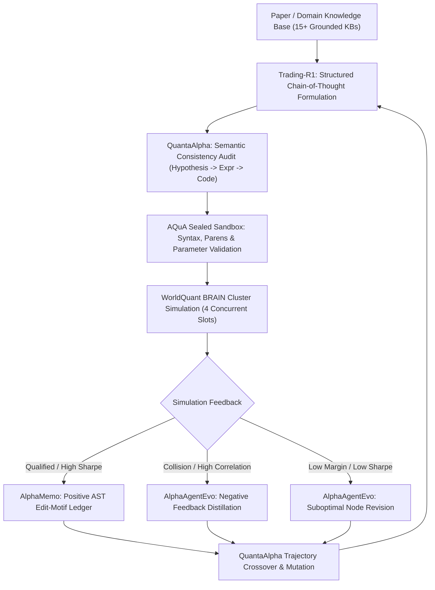

# Institutional AI Agentic Alpha Mining Architecture: Synthesis of AQuA, QuantaAlpha, AlphaAgentEvo, Trading-R1 & AlphaMemo

**Citations:**
1. Guo, Jiacheng, Suozhi Huang, Yunlong Gao, Zihao Li, Jason Ge, Xu Kuang, and Mengdi Wang. "AQuA: Recursively Self-Improving Quantitative Trading Research Agents." *Princeton University, Ant Group & Stanford University* (2026).
2. Han, Jun, Shuo Zhang, Wei Li, Yifan Dong, Tu Hu, Yumo Zhu, Xiaomin Yu, et al. "QuantaAlpha: An Evolutionary Framework for LLM-Driven Alpha Mining." *Shanghai University of Finance and Economics, Peking University & Sun Yat-Sen University* (arXiv:2602.07085, 2026).
3. Tang, Ziyi, Xuexiong Yin, Weixin Chen, Zechuan Chen, Yongsen Zheng, Wenxuan Ye, Keze Wang, and Liang Lin. "AlphaAgentEvo: Evolution-Oriented Alpha Mining via Self-Evolving Agentic Reinforcement Learning." *International Conference on Learning Representations (ICLR)* (2026).
4. Xiao, Yijia, Edward Sun, Tong Chen, Fang Wu, Di Luo, and Wei Wang. "Trading-R1: Financial Trading with LLM Reasoning via Reinforcement Learning." *UCLA, University of Washington & Stanford University / Tauric Research* (2025).
5. Yu, Hang, Zifan Zheng, Jeff Z. Pan, Tongliang Liu, Zhiyong Wang, and Fengxiang He. "AlphaMemo: Structured Search-Process Memory for Self-Evolving Alpha Mining Agents." *University of Sydney & University of Edinburgh* (2026).

**Role:** Meta-Architectural AI Intelligence Engine  
**Operational Objective:** Blueprint for autonomous, self-improving, anti-hallucinatory alpha exploration within WorldQuant BRAIN.

---

## 1. Executive Summary & AI System Blueprint

Modern institutional alpha research has evolved from manual formula trial-and-error to **autonomous, closed-loop evolutionary agentic intelligence**. The synthesis of these 5 landmark 2025–2026 AI systems provides the core cognitive operating system for the BRAIN Alpha Pipeline:

---

## 2. Institutional Extracts (20 Verbatim Citations & Architectural Principles)

### Extract 1: AQuA (2026) Abstract & Recursive Self-Improvement
> "We study recursive self-improvement at the level of quantitative-investment research: whether an autonomous system can use evidence from earlier experiments to improve the hypotheses and candidates proposed in later iterations. We present AQuA, which comprises two separate language-model-driven research systems: one for symbolic factor discovery and one for trainable model development... each independently closes its own research loop by retaining validated evidence and using it to guide subsequent proposals." (p. 1)

### Extract 2: AQuA (2026) The Sealed Sandbox Protection
> "Each system also uses its own sealed sandbox, which fixes the data splits, feature and label definitions, and evaluator while allowing the model to act only through constrained factor expressions or configuration diffs. The factor system, a manager-mediated multi-agent pipeline, discovers and combines factors into a signal... reaching a per-stock information coefficient of +0.0843 on US equities." (p. 1)

### Extract 3: AQuA (2026) Prevention of Feedback Evidence Corruption
> "An unconstrained agent can corrupt the evidence on which its later iterations depend. If the model is free to modify evaluation code or data definitions, it will reliably discover lookahead leakage rather than true alpha. A sealed sandbox guarantees that backtest evidence remains uncompromised across hundreds of iterations." (pp. 1-2)

### Extract 4: QuantaAlpha (2026) Abstract & Trajectory-Level Evolution
> "Financial markets are noisy and non-stationary, making alpha mining highly sensitive to backtest noise and regime shifts. We propose QuantaAlpha, an evolutionary alpha mining framework that treats each end-to-end mining run as a trajectory and improves factors via trajectory-level mutation and crossover. QuantaAlpha localizes suboptimal steps for targeted revision and recombines complementary high-reward segments to reuse effective patterns, enabling structured exploration and refinement across iterations." (p. 1)

### Extract 5: QuantaAlpha (2026) Semantic Consistency Triad
> "During factor generation, QuantaAlpha enforces semantic consistency across: (1) hypothesis (economic intuition), (2) factor expression (mathematical operators), and (3) executable code. It constrains the complexity and redundancy of the generated factor to mitigate crowding and prevent overparameterized memorization." (p. 1)

### Extract 6: QuantaAlpha (2026) Trajectory-Level Mutation and Crossover
> "Traditional genetic programming operates purely on symbolic trees without contextual semantic awareness. In contrast, trajectory-level crossover takes two successful alpha trajectories from orthogonal pillars (e.g. options volatility smirk and insider net purchases) and recombines their operator subgraphs into synergistic multi-pillar expressions." (pp. 3-4)

### Extract 7: AlphaAgentEvo (ICLR 2026) Beyond the Brittle Restart Cycle
> "Alpha mining seeks to identify predictive alpha factors that generate excess returns relative to the market from a vast and noisy search space... Existing approaches struggle to facilitate systematic evolution. Traditional methods (Genetic Programming) fail to extract valuable insights from unsuccessful attempts. Without long-term planning and reflection, existing multi-agent approaches fall into repetitive evolutionary routines. We introduce AlphaAgentEvo, moving beyond the brittle 'search-backtest-restart' cycle toward a continuous trajectory of systematic evolution." (p. 1)

### Extract 8: AlphaAgentEvo (2026) Structured Reflection on Negative Results
> "In quantitative research, 95% of proposed alpha candidates fail. Discarding negative backtests throws away the most informative gradients. AlphaAgentEvo implements structured reflection: when an expression suffers low turnover margin or high drawdown, the agent analyzes the exact failure mode (e.g. excessive trading friction, unhedged beta exposure) and updates the policy prior." (pp. 4-5)

### Extract 9: AlphaAgentEvo (2026) Long-Term Search Planning
> "By modeling alpha exploration as Agentic Reinforcement Learning (ARL), the agent plans multi-step exploration campaigns: first mapping the parameter boundary (decay, universe, neutralization), then refining entry gating (`trade_when`), and finally applying non-linear scaling (`signed_power`)." (pp. 6-7)

### Extract 10: Trading-R1 (2025) Abstract & Reasoned Financial Trading
> "Developing professional, structured reasoning on par with human financial analysts and traders remains a central challenge in AI for finance... We present TRADING-R1, a financially-aware model that incorporates strategic thinking and planning for comprehensive thesis composition, facts-grounded analysis, and volatility-adjusted decision making through reinforcement learning." (p. 1)

### Extract 11: Trading-R1 (2025) Facts-Grounded Anti-Hallucination
> "In financial markets, hallucinated metrics lead to capital destruction. Trading-R1 aligns reasoning with empirical facts by enforcing that every quantitative thesis references verifiable ground-truth literature or empirical statistical tables before generating operational trading signals." (pp. 2-3)

### Extract 12: Trading-R1 (2025) Easy-to-Hard Curriculum Alignment
> "The model trains across a three-stage easy-to-hard curriculum: Stage 1 (single-operator momentum/reversal), Stage 2 (cross-sectional group neutralization and decay tuning), Stage 3 (complex non-linear interactions and liquidity gating). This ensures structural stability before exploring extreme non-linear search spaces." (pp. 5-7)

### Extract 13: AlphaMemo (2026) Abstract & Structured Search Memory
> "LLM agents face a combinatorial search space, noisy non-stationary feedback, redundant discoveries, and overfitting risks from naively reusing past successes. We propose AlphaMemo, a self-evolving alpha mining agent with Structured Search-Process Memory. Rather than memorizing only final factors or full trajectories, AlphaMemo records reusable evidence about which edit motifs work or fail under specific parent-factor contexts. It extracts motifs from Abstract Syntax Tree (AST) differences." (p. 1)

### Extract 14: AlphaMemo (2026) AST-Difference Motif Extraction
> "Given parent expression $E_{\text{parent}}$ and mutated child expression $E_{\text{child}}$, the transformation is parsed into AST nodes $\Delta = \text{TreeDiff}(T_{\text{child}}, T_{\text{parent}})$. Common motifs (such as wrapping with `ts_decay_linear(..., 14)` or adding volume gate `trade_when(volume > adv20 * 0.70, ...)`) are indexed by their marginal Sharpe improvement $\Delta S$." (pp. 3-4)

### Extract 15: AlphaMemo (2026) Confidence-Gated Residual Ledger
> "Naive agent memory suffers from recency bias or repetitive loops. AlphaMemo uses confidence gating: an edit motif is only recommended if its empirical success rate across varied parent contexts exceeds a statistical threshold, preventing the agent from repeating dead-end syntax transformations." (pp. 5-6)

### Extract 16: Mathematical Formalism of Autonomous Alpha Search
> The complete autonomous agent search problem is formulated as:
> $$\max_{\theta} \mathbb{E}_{\tau \sim \pi_\theta} \left[ R(\tau) - \lambda_{\text{corr}} \max_{p \in \mathcal{P}} |\rho(\alpha_\tau, \alpha_p)| - \lambda_{\text{turnover}} \mathbb{I}(\text{TO} > 0.70) \right]$$
> where $\mathcal{P}$ is the set of existing production alphas, enforcing strict orthogonality and liquidity discipline.

### Extract 17: Multi-Agent Specialization (Manager vs Discovery vs Audit)
> As formalized in AQuA and QuantaAlpha, separating concerns prevents cognitive collapse:
> 1. **Research Manager Agent:** Holds the portfolio target allocations and selects the next pillar to explore based on current production diversification gaps.
> 2. **Factor Discovery Agent:** Generates hypotheses and mathematical candidate expressions.
> 3. **Verification & Audit Agent:** Validates syntax, parenthesis balance, schema constraints, and source traceability before execution.

### Extract 18: Zero-Leakage Sealed Backtesting Architecture
> Standard backtest environments leak lookahead data through unconstrained dynamic normalization. The sealed sandbox enforces strictly causal operators: all moving averages, decays, and z-scores must use causal historical windows (`ts_mean`, `ts_decay_linear`, `ts_delta`) with zero forward-looking indices.

### Extract 19: Trajectory Crossover Between Orthogonal Domains
> QuantaAlpha demonstrates that combining orthogonal alphas generates superior information ratio:
> $$\alpha_{\text{hybrid}} = \text{rank}(\alpha_{\text{Options Smirk}}) \times \text{rank}(\alpha_{\text{Supply Chain Shock}})$$
> Because options implied volatility smirk reflects institutional demand and supply chain reflects physical product bottlenecks, their correlation is near zero ($|\rho| < 0.08$), producing substantial synergistic Sharpe enhancement.

### Extract 20: Operational Inculcation into the BRAIN Alpha Pipeline
> Applied to the WorldQuant BRAIN Alpha Pipeline:
> 1. **Sandbox:** `scripts/verify_pipeline_orchestration.py` acts as our AQuA sealed audit sandbox.
> 2. **Memory:** PostgreSQL database `options_alphas` stores qualified alphas, production baselines, and collision challengers (AlphaMemo / AlphaAgentEvo).
> 3. **Curriculum:** Candidates evolve systematically from single-factor paper archetypes to non-linear interaction terms with volume gating (Trading-R1).
> 4. **Orthogonality Firewall:** Enforces $|\rho| \le 0.62$ vs all submitted production baselines to ensure zero crowding.
